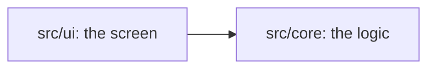

# Architecture

> **Covers:** `src/main.ts`, `src/core/tally.ts`, `src/ui/app.ts`, `src/ui/messages.ts`, `src/ui/styles.css`, `index.html`, `vite.config.ts`
> **Checked against the code:** 2026-11-23

The app is a TypeScript web app built with Vite (decision 2). This page starts with the template's tiny starter app; replace it as the real app grows.

## The two parts

| Folder | What's in it | Rules |
|---|---|---|
| `src/core/` | The logic | Plain functions with no screen code; data is never changed in place; every file has tests beside it (`*.test.ts`) |
| `src/ui/` | The screen | May use `src/core/`; `src/core/` never uses `src/ui/`. All wording is in [`messages`](../../src/ui/messages.ts) |

Keeping the logic apart from the screen means it can be tested quickly and thoroughly, and the screen can change without breaking it.

## How the app starts

1. [`index.html`](../../index.html) loads [`src/main.ts`](../../src/main.ts).
2. `main.ts` finds the page's `#app` element and hands it to [`startApp`](../../src/ui/app.ts).
3. `startApp` builds the screen and shows the current state.

## The starter app: a tally

A placeholder that shows the pattern every feature follows:

- **Logic** in [`src/core/tally.ts`](../../src/core/tally.ts): a [`Tally`](../../src/core/tally.ts) is plain data. [`addToTally`](../../src/core/tally.ts) and [`undoTally`](../../src/core/tally.ts) return a new tally rather than changing the old one, which makes Undo simple.
- **Screen** in [`src/ui/app.ts`](../../src/ui/app.ts): a large Add button (easy to tap), Undo, and the count; it writes the count into `data-count` for the whole-app tests.
- **Look** in [`src/ui/styles.css`](../../src/ui/styles.css): every button at least 44 pixels, for fingers.
- **Build** with [`vite.config.ts`](../../vite.config.ts), which also tells Vitest where the logic tests are.

## Where to change things

- New logic: a new file in `src/core/`, with its tests beside it.
- New screens or controls: `src/ui/`; their words go in `messages.ts`.
